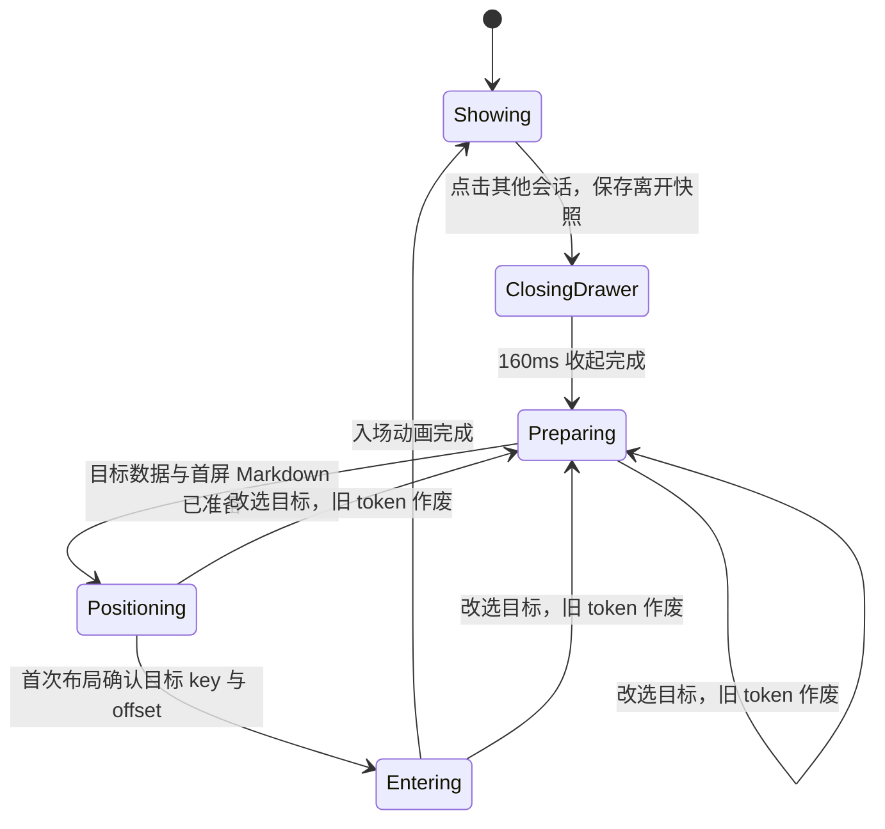

# 聊天阅读位置、会话切换与设置样式重构设计（草案）

日期：2026-10-27。基线：已安装的 Release 0.8.534 / vc555，HEAD 004c0a5 加当前工作树。

状态：**用户已批准 B 方案**（2026-10-27，原话「可以，按B方案做，P4只做必要的内部定位适配，外观和交互等我说」），源码已按本文实现于工作树（版本 0.8.534 / vc555，未提交、未出包、未安装），并通过 `:app:compileReleaseKotlin`。**真机行为一律未验收**：切换动画与掉帧、位置是否到位、P1 原位、P2 第二菜单、设置观感、绿点端到端，都不能据源码宣称通过。

## 用户这轮验收

| 项目 | 用户反馈 | 当前结论 |
|---|---|---|
| 后台正常完成未读绿点 | 有了，可以了 | 用户验收通过 |
| P1 加载更早 | 有些位置变，有些不变 | 未通过，不能按部分样例通过关闭 |
| P2 复制菜单 | 仍出现第二个菜单，只有“全选” | 未通过；旧的“只有重复 SelectionContainer”解释不充分 |
| 输入法 | 还可以了 | 当前体验用户接受，保持 |
| P4 导航条 | 后面听用户指示重构 | 暂缓设计和外观、交互改造 |
| 会话切换 | 不再卡几秒，但切后掉帧、无动画、位置迟到 | 读盘等待改善不等于切换完成 |
| 设置页 | 状态按钮丑、分割线多且位置不合理 | 字号和边距规则不等于风格验收通过 |
| 折叠与抽屉 | 没问题 | 当前行为用户验收通过 |
| P3 注入开关 | 没问题 | 记录为用户体验验收通过；本轮未另取手机请求、日志 |

## 已确认的实现问题

以下行号对应本次调查时的工作树，后续实施后以符号定位。

1. `ChatScreen.kt:217` 的 `rememberLazyListState()` 没有按会话隔离。所有会话在同一个列表状态上换内容。
2. `ChatScroll.kt` 同时保存 `spots`、`spotByConversation`、`lastSeenByConversation`；`ChatScreen.kt:1111` 又维护 `anchors`。它们是内存 Map，不是持久化阅读书签。注释把写 Map 叫“落盘”不准确。
3. `ChatScreen.kt:1171` 的 anchors 收集器要求 Lazy item 的 key 属于消息 ID 集合；实际历史正文在 `item(key = "transcript")` 中。正文消息 ID 并非 Lazy item key，该路径无法按原意采集消息锚点。
4. `ChatScreen.kt:1285` 起的填充协程把同一会话逐批挂载；`:1556` 起的恢复协程等全部填完，再等两帧，最后 `scrollToItem`。新会话正文可以在位置恢复前被看见，填充又在可见阶段继续产生组合、测量工作。热点会话缓存只缓存消息，不缓存已完成的整个界面布局。
5. `ChatScreen.kt:1057` 的 `Animatable` 初值固定为 1，effect 首帧即返回。入场动画是被代码关闭的，不是这次偶发没播。旧注释还混存着几种被放弃的动画方案。
6. P1 当前捕获消息行顶边 windowY，等“新前缀有放置事件”后，至多执行一次 `scrollBy`。这是显示后的补偿。它没有把数据、列表位置和首次可见布局合成一次提交，也没有证明补偿之后行高不会再改变。因此不同位置、不同内容和边界状态可以表现不同；没有本轮真机轨迹，不能断言每一次漂移的具体来源。
7. `SelectableWhenArmed` 只登记焦点，外层点按只 `clearFocus()`，没有直接管理选区对象。核对本机实际 foundation-android 1.12.1 二进制，已有公开的 `SelectionState`、`rememberSelectionState()` 和 `SelectionState.clear()`；clear 会调用框架的完整 release。框架菜单对“复制”和“全选”分别判断可用性，所以缺少复制的菜单并不反证它来自正文。这个机制与用户反馈吻合，但第二菜单的实际发起者仍待修复后验收，不能当成已经复现的证据。
8. 设置页 `SegmentedPill` 固定 CircleShape、整块 primary 高亮；`SettingsScreen.kt` 多处在已分组的控件后另画整宽分割线，首页卡内还逐行画线。视觉层级重复，样式表并未收敛这些规则。

调查仅使用源码、本地依赖二进制和上游公开源码；没有操作手机、读取应用日志或聊天数据。

## 候选方案与建议

| 方案 | 实际改变 | 收益与代价 |
|---|---|---|
| A：保留单 transcript，收敛状态和展示时序 | 每会话独立书签，隐藏未完成的初始布局，统一选区关闭与设置控件 | 能消除部分位置迟到和错误归属；已加载历史仍全量布局，无法据此宣称切换、长历史的布局成本已解决 |
| B：按消息卡片虚拟化，统一阅读状态和显示提交 | 正文变为有稳定 key 的真正 Lazy item；仅布局可见区和有界预取区；首屏先就位再呈现 | 直接改变目前的全量布局成本，也可用列表原生锚定承接分页；改动面较大，必须防止旧的“每张卡进视口顿一下”回归 |
| C：保留多份完整会话界面常驻 | 用大量常驻组合换热点切换速度 | 内存、布局订阅和后台开销随会话数增长，冷会话和加载历史仍有原问题，不建议 |

建议 B，但它属于用户以前明确“单 transcript 先不做”的范围。本次“可以进行重构设计”足够授权调查和设计，不自动记为已批准结构替换。A 可作为用户继续保留该限制时的有限方案，必须同时保留 CHAT-R-07 未完成。

旧方案为什么不能原样搬回：[#43 的原始讨论](https://github.com/zeng6125-rgb/suixing/issues/43)记录了新卡进入视口的组合、排版尖峰；最后用整页单 item 换取滚动时常驻。B 必须补上有界预取、重卡成本控制及快滑验收，不能简单把 Column 换成 items 然后用单测数宣布完成。该讨论的旧帧率数字不是 534 的测量证据。

## 方案 B 的目标和边界

- 切回会话时，第一份可见正文已在记住的位置；没有“先显示、后滚动纠正”。
- 加载更早时，旧消息的稳定身份和列表锚点连续，不在可见阶段逐帧补页或反复纠偏。
- 切换动画在正文和位置就绪后只播放一次；等待内容准备不是动画时长的一部分。
- 点击空白使真实选区与所属菜单一起结束；保持同一条回答内跨段落、列表、代码块拖选。
- 保持当前通过的输入法、绿点、折叠和抽屉收起行为。
- 不改聊天日志、保存协议、恢复副本节奏、模型请求、缓存容量 8 或超长表格折叠规则。
- P4 外观和交互重构仍等用户指示。列表替换必需的位置适配单独列出，不顺便改导航样式或操作定义。

## 统一阅读位置

拟议 `ConversationViewport` 是唯一的阅读状态所有者，取代互相兜底的多个 Map。书签包含：

```text
conversationId
anchorRowKey / anchorMessageId
offsetWithinRowPx
followLatest
loadedWindowBoundary
layoutFingerprint（宽度、字号等影响换行的配置）
sequence
```

每个会话拥有独立列表状态，恢复时不能借用另一会话的 index/offset。根据目标会话已经准备好的 rows 解析稳定 key，构建列表的初始 index/offset；不是先展示默认位置，再由多个 effect 抢着滚动。

只有 `Entering/Showing` 阶段、且已经确认属于该会话的有效布局能覆盖书签。`Preparing/Positioning` 阶段被再次切走或退后台时，保留目标原书签，不能采集隐藏列表的默认 `(0, 0)` 当作新阅读位置。离开会话的有效快照在开始切换前已经采集，不依赖下一会话的布局回调补存。

切走前同步采集当前布局快照，原子更新内存书签；经单一 IO 写入队列异步持久化到独立 UI 偏好，不触碰聊天正文文件。暂停/离开时也提交当前快照。写入按会话 sequence 丢弃旧事件，删除会话清理书签。内存书签是本进程恢复的来源，切换不等待磁盘写完。

确切保证：正常进程内切换使用刚采集的位置；正常退出后使用最后成功持久化的书签。突发进程终止可以丢失尚未写完的最近位置，不能为此阻塞主线程。屏宽、字号变更时优先恢复相同消息，失效像素偏移降级处理，不承诺不同换行布局仍是同一个屏幕像素。

读取的历史窗口必须包含目标消息。若冷缓存仅有最近窗口，先按现有只读能力补到书签边界后再显示；若现有接口无法有界定位该消息，应先扩展只读定位接口或保留明确等待状态，不能为了快速就绪悄悄回到底部。确实删除或分支切换使目标消失时，用可追溯的相邻消息回落规则。

## 切换与呈现时序



全部异步结果携带 `conversationId + switchToken + contentRevision`。快速改选时，旧读盘、准备、布局确认和动画回调均不能更新新会话。

保持抽屉四条收起路径的 `DRAWER_CLOSE_SPEC`（160ms、FastOutLinearIn）和右侧透明点击层。点击会话依旧先收起再切换。聊天内容进入准备阶段时立即归属目标会话，不能在新标题下展示旧会话正文。

冷路径可展示加载占位；热路径从已准备数据直接建立目标首屏。隐藏的准备不得持续遮盖整页全量组合：方案 B 只建立首屏及有限预取范围。首次正确布局后再呈现内容，同一 revision 不再靠固定“等两帧”修位置。

入场动画使用单份目标内容的 graphicsLayer，拟采用短淡入与轻位移，数值由共享转场规格统一；不同时保留两份整页长内容做 crossfade。读取动画值只发生在绘制阶段。动画完成后仍是一套稳定节点，避免条件增删修饰符导致残影。当前尚未确定最终曲线和时长，不能把草案数值当成用户已选样式。

### 流式会话、空会话和已读确认

切换令牌只因用户改选目标而更新。逐 token 增量不属于取消首次就位的结构版本；准备使用一份足以恢复目标的结构快照，匹配该快照的首次布局即可确认就位。其间的正文增量由独立 live 状态接续，不重置准备、不重新播入场。确有新增/删除历史行时，准备阶段可在该快照上接入可兼容的后续版本；不兼容的编辑/分支操作才显式重新准备。

live item 在本次 run 内保持唯一的 presentation key；历史行继续使用主消息稳定 key。完成时一次性发布 live 移除与定稿行插入，并提供 live 内容块到最终 row 的映射：跟底者保持跟底，历史阅读者继续持有历史 key；正在读 live 气泡的人，按内容块映射转交锚点，不能因 run 完成无条件回底。一个 run 被插话分成多段时，映射必须区分段，不能让多个定稿行复用同一个 run key。这里的段身份只属 UI 呈现数据，不修改盘上聊天日志。

就绪结果有明确三类：有历史正文、仅 live 内容、已加载且确实为空。不能以 `visible.isNotEmpty()` 作为所有会话唯一就绪条件；空会话可以正常呈现空状态，live-only 会话可以呈现当前运行，不永远等历史行。

完成未读绿点的已读条件还必须要求该会话已进入实际正文呈现阶段，不能在 `Preparing/Positioning` 中仅因 messages 到内存就清绿点。切换等待时报告 viewing(null)，目标正文可见且 Activity RESUMED 后才确认已读；其它导航页仍不确认。

## 列表、加载历史与旧回归防线

- 用户消息、完整助手回答、必要状态行均有独立、稳定、唯一的 Lazy key 和 contentType。同一条回答内部保持普通连续内容，选区不包住会回收子项的 Lazy 容器。
- 分页以完整轮为边界。工具/助手分组不能因补前缀就无条件更换既有 row key；确有合并时建立主消息 ID 到稳定行的映射。
- 已加载历史不再逐帧提升 filledRows 让用户看见页面变长。后台准备新页解析结果，在同一次 UI 提交中发布新的 rows；列表用原有可见 key/offset 原生保持位置。分页后不用可见的 scrollBy 修补。
- 行内图片预留与最终解码一致的尺寸，折叠状态按会话/块 ID 恢复，防止就位后再改变行高。这里调整的是占位与状态归属，不重写用户已接受的折叠动画。
- 初始 ListState 的 key/offset 在第一次测量之前确定。用户主动拖动立即获得控制权，旧恢复任务不能在拖动后再拉回。
- 对实际 1.12.1 的 Lazy 预取/缓存窗口 API 做本地签名核对后使用有界窗口；不预先创建全历史、全部 8 份会话界面，也不扩大正文缓存掩盖布局成本。
- 长定稿 Markdown 沿用后台解析准备；图片解码沿用既有缓存。排版仍在 UI 线程，不能把后台解析说成后台完成全部布局。超长单卡、表格仍可能超预算，继续作为限制列明。
- 同时验收向上、向下快速 fling，反复经过同一张重卡；旧 #43 的“进视口顿”只要重现，就不能判定 B 通过。

## P2：以真实选区为准关闭菜单

拟把 `SelectableWhenArmed` 的外层容器改为拥有显式 `rememberSelectionState()` 的消息选区；内层仍通过 LocalInSelectable 透传，不能重复创建管理器。

选区协调器登记 owner、当前有效选区和 release 回调，不能只用 `hasFocus` 代表选区存在。短点空白时按手势顺序释放该 owner 的真实选区并关闭其菜单；取消、换会话、容器销毁均释放所有权。只清正文，输入框自己的焦点、草稿和编辑菜单保持独立。

正文菜单只在该 owner 的有效选区会话中提供动作；完整 release 后，迟到的菜单数据不能留下一个“全选”。优先使用框架 SelectionState 与公开上下文菜单 API，不用隐藏系统全选、反射调用内部管理器、定时多次 clearFocus 或自绘菜单替代。

如果第二菜单实际由输入框、系统智能选择或另一个容器发起，应继续定位其所有者，不能因上述机制解释得通就宣称已经抓到实际发起者。无手机日志/埋点权限，验证采用源码、可隔离的状态用例和用户手动复验。

## 设置页：统一控件角色，减少重复分隔

拟议视觉规范：

| 类型 | 规则 |
|---|---|
| 开/关 | 一套共享 Switch 色彩和状态；保留至少 48dp 触控区，不按页面自行缩放 |
| 两到四项互斥模式 | 一套圆角分段选择器；浅底轨道、低饱和选中块、明确文字/选中语义，替换整块高饱和胶囊 |
| 页面分栏 | 沿用相同基础字体与间距，但有 tab 语义，不和开关混为同一类 |
| 普通行之间 | 默认用留白，不在每行后画整宽线 |
| 不同分组 | 用分组标题和共享间距区分，已分卡时不再重复叠线 |
| 描述与所属控件 | 作为同一组，不在二者之间插线 |
| 危险操作、确需分隔的列表边界 | 允许单条弱分隔；每个保留位置说明用途 |

保留已统一的 16dp 页边距/普通卡内距、12dp 组间距及主题字体角色。检查模型、会话、外观、网络语音、数据、记忆、画像、工具/技能/MCP/插件、助手、用量、性能和关于页；检查同类控件一致，不要求统计数字、徽标和正文同字号。

本次是拟议样式，尚未由用户确认选中态形态；实施时优先共享组件，再逐页决定分隔线的语义，不做全文批量删线。

## P4 依赖边界

列表虚拟化后，未挂载行没有 LayoutCoordinates。现有导航回调依赖全部行的坐标，因此方案 B 不能假装完全不影响它。必要适配限于：用稳定 row key/全局轮号定位 Lazy index；使用当前可见行确定阅读轮次；目标行挂载后才做一次所需的对齐。

导航条的颜色、尺寸、分组、交互以及用户下一步要给的重构方案不在这里擅自确定。如果用户要求连这个内部适配也暂缓，应先实施独立的 P2 与设置样式，保留 B 为待办，不能交付一个点击导航失效的中间版本。

## 验证和完成条件

代码实施获准后，只使用 Release 编译；如需执行新增纯函数/协程测试，使用 Release 对应测试变体，先核对任务依赖不会触发 Debug。当前草案没有改应用代码，不运行应用构建来制造“设计已验证”的口径。

有意义的自动验证覆盖：会话书签隔离与旧事件拒绝、持久化关闭重开、删除清理、分页前后 key/offset 对应、切换 token 取消、锚点缺失和布局配置改变的回落。它们不能证明 UI 帧率、系统菜单数量和动画顺滑。

人工验收至少覆盖：

1. P1：纯文字、图片/折叠块附近、旧窗口边界各加载 2～3 页；记住的文字位置稳定。加载中拖动/切会话，旧任务不抢位置。
2. P2：长按、空白点按、等待、切会话再重复；不出现第二个“全选”。同一回答跨段落、列表、代码块拖选仍连续。
3. 切换：热点 A/B、超过缓存容量的冷会话、长会话历史位置、另一会话流式时切换。第一份正文即在正确位置，动画只播一次，不先闪旧内容；快速改选只以最后一次为准。
4. 滚动：上下快滑、多次经过旧重卡；既不把打开时开销挪回滚动帧，也不静态承诺零掉帧。
5. 设置：浅/深色、大字号、窄屏、长标签；控件风格一致，选中/禁用清楚，分隔线只在有语义的位置。
6. 回归：已通过的绿点、输入法、折叠、P3 和抽屉保持正常，P4 现有操作可用。

打包、安装与发布仍按当轮授权进行；本次反馈本身不是安装下一版本的授权。#50 保持未完成项开启，不能把本设计记成修复。

## 本次证据和后续交付范围

- 本次只读核查应用源码、实际依赖签名、#43 原始讨论；新增本设计并记录用户验收结果。
- 未修改应用源码或版本号；未编译、打包、安装、操作手机、读应用日志/聊天数据、提交或 push。
- 下一步需要用户明确是否采用 B，解除此前单 transcript 结构暂缓；P4 仅允许必要位置适配还是全部等用户指示，也由该确认确定。
- R4 保存节奏、活跃恢复副本协议、超长表格折叠继续保留此前暂缓，不搭车改动。

设计独立复核提出了两处实质遗漏，已补：流式目标的结构快照/live 增量/定稿身份接续，以及准备中被切走或退后台不能覆盖有效书签。复核不是 UI 验证。

上游机制参考：[SelectionContainer](https://raw.githubusercontent.com/androidx/androidx/androidx-main/compose/foundation/foundation/src/commonMain/kotlin/androidx/compose/foundation/text/selection/SelectionContainer.kt)、[SelectionManager](https://raw.githubusercontent.com/androidx/androidx/androidx-main/compose/foundation/foundation/src/commonMain/kotlin/androidx/compose/foundation/text/selection/SelectionManager.kt)。这是上游主分支参考；具体可用签名已经用本机实际 1.12.1 二进制核对，不把主分支全部 API 当成本项目已经可用。
